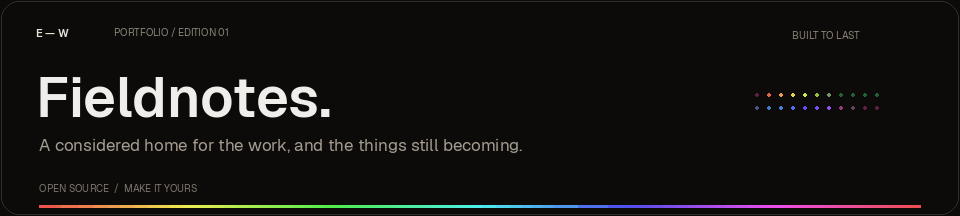
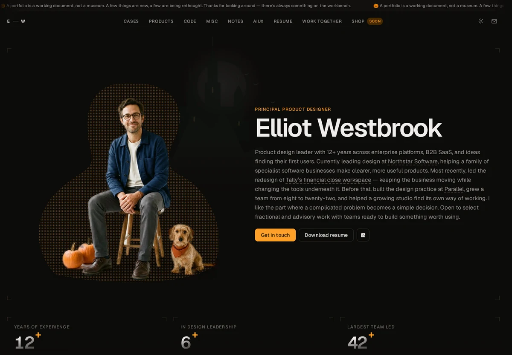

<div align="center">
  

# Fieldnotes Portfolio

An editorial portfolio for people who make useful things.  
Original artwork. Considered motion. A practical, static-first foundation.

**Next.js 16 · React 19 · TypeScript · Tailwind CSS 4 · Three.js · Geist**

</div>


## A little less portfolio theater

A long-form portfolio with room for the work, the person behind it, and the things still on the workbench. Warm dark and light themes, expressive product panels, a moving studio wall, and small interactions that serve the content rather than interrupt it.

This is an independently implemented visual study of [product.inc](https://www.product.inc/), with a new fictional identity, rewritten content, original product interfaces, and original imagery. It is not an official theme, a source-code copy, or an endorsement by the reference’s creator.

<p align="center"></p>


## What’s inside

### One complete portfolio, not just a landing page

- **A full-length homepage** — seasonal hero, six animated metrics, eight case studies, product launches, experiments, studio gallery, notes, a forty-pattern AIUX field guide, career timeline, services, and a small concept shop.
- **Seventy application routes** — the homepage, eight case studies, five experiments, three complete notes, forty pattern articles, and the supporting product, service, personal, and shop pages.
- **Original local assets** — handcrafted SVG product interfaces, theme-aware cover images, original generated photography and collectible concepts. No reference-owner image URLs or runtime image CDN dependencies.
- **A real downloadable sample résumé** — included as a two-page PDF. Replace it before using the portfolio professionally.

### Motion with a purpose

- A pointer-responsive Three.js particle form, with a static fallback.
- Portrait parallax, count-up metrics, section reveals, and reading progress.
- An animated announcement, logo treatment, studio wall, and client strip.
- Drag, swipe, arrow, and keyboard-friendly collection browsing.
- Native modal dialogs with Escape dismissal; studio artwork supports arrow-key browsing and zoom.
- Persistent dark/light themes, responsive navigation, and a reduced-motion treatment.

### Working local interactions

Load more work, expand the timeline, search and filter notes or patterns, inspect sources in the pattern examples, retry a recoverable demo error, undo a demo action, pause a walkthrough, switch product/code tabs, and try a reversible food-log entry.

Product-interest forms prepare a `mailto:` message. They do **not** claim to submit to a nonexistent database. The concept shop takes no payments. The case-study phrase gate is explicitly **not authentication**.

<p align="center"></p>


## Preview

### Requirements

Use **Node.js 22.x** and npm. No API keys, database, account, or environment file are required to run the template.

### Development

```bash
cd fieldnotes-portfolio
npm ci
npm run dev
```

Open **http://localhost:3000** on the same computer. Changes update automatically.

### Preview the actual production export

```bash
npm run build
npm run preview
```

Open **http://localhost:4173**. `npm start` is an alias for this static preview server and also requires a completed build.

> Do not double-click a source file or expect an uploaded source ZIP to become a website. Next.js builds the site first. The included Pages workflow handles that build for you.

### Useful commands

| Command                  | Purpose                                                          |
| ------------------------ | ---------------------------------------------------------------- |
| `npm run dev`            | Local development with hot reload                                |
| `npm run typecheck`      | Generate route types, then check TypeScript                      |
| `npm run build`          | Create the deployable static site in `out/`                      |
| `npm run preview`        | Serve the production export on port 4173                         |
| `npm run check`          | Type-check and build in sequence                                 |
| `npm run format`         | Format the editable source and documentation                     |
| `npm run upload:batches` | Prepare safe, path-preserving browser-upload batches of 80 files |


## Make it yours

**Start with `lib/content.ts`.** It contains the identity, contact details, links, navigation labels, metrics, projects, experiments, notes, patterns, roles, gallery, and shop data.

| Change                                                               | Where                                               |
| -------------------------------------------------------------------- | --------------------------------------------------- |
| Name, initials, email, social profiles, site URL, seasonal switch    | `lib/content.ts` → `site`                           |
| Case studies, metrics, career history, writing, patterns, shop items | The corresponding arrays in `lib/content.ts`        |
| Homepage introduction, service cards, client strip                   | `components/Portfolio.tsx`                          |
| Product concepts and device interfaces                               | `components/ProductPanels.tsx`                      |
| About copy, skills, service rates, and supporting pages              | `components/InteriorPages.tsx`                      |
| Case-study presentation and demo-only phrase gate                    | `components/CaseStudy.tsx`                          |
| Colors, spacing, type scale, responsive behavior, motion             | `app/globals.css`                                   |
| Website title and social metadata                                    | `app/layout.tsx`                                    |
| Images, icon, social preview, résumé                                 | `public/`                                           |
| Hosting and repository-path behavior                                 | `next.config.ts` and `.github/workflows/deploy.yml` |

1. Replace **every fictional credential, outcome, company relationship, date, and rate** with your own verified content. Replace the generated portrait with your own photo if this represents you.
2. Replace `hello@example.com` and the generic social-platform URLs with real destinations, or remove links you do not need.
3. Replace the sample PDF and update its filename in the download links if necessary.
4. Set `site.url` to the final website URL. The sitemap intentionally stays empty while this is `https://example.com`.
5. Replace `public/og.webp`, `public/icon.svg`, and `public/site.webmanifest` as needed. Add your real sitemap URL to `public/robots.txt`.
6. Keep confidential material out of the public source and exported website. The Dispatch access phrase is `fieldnotes`; anyone can read the source or download the underlying files.

**Adding more content:** use a unique slug, add the appropriate local image, and follow an existing entry. Project, experiment, note, and numbered pattern routes are generated from the content arrays. The homepage’s example load-more counts are intentionally tuned to the supplied collection; update those controls if you change the collection sizes.


## Deploy to GitHub Pages

The source includes a complete GitHub Actions workflow. **No Git CLI is needed to upload it.**

1. Create a repository, for example **`fieldnotes-portfolio`**, using **`main`** as its default branch.
2. Extract the source archive. At the repository root, use **Add file → Upload files** and drag in the **contents** of the project folder. `package.json`, `app/`, and `public/` must be at the root — not inside another `fieldnotes-portfolio/` folder.
3. Include hidden files, especially `.github/workflows/deploy.yml` and `.gitignore`. Do **not** upload `node_modules/`, `.next/`, `out/`, secrets, or private owner material. `.gitignore` does not filter files you manually drag into a browser.
4. In **Settings → Pages → Build and deployment**, select **GitHub Actions** as the source.
5. Open **Actions → Build and deploy portfolio**. If needed, choose **Run workflow → main**. Wait for both build and deploy jobs to finish.
6. Open the URL shown in the deployment. A project repository is normally served at `https://Muhammad112233-creator.github.io/Portfolio-Template-34/`.

The workflow uses the repository name to set Next.js’s base path automatically. A `YOUR-USERNAME.github.io` user-site repository uses the domain root instead. If you later add a custom domain that serves this project at `/`, review that setting before rebuilding.

### Other static hosts

A normal `npm run build` produces an unprefixed `out/` folder for a domain-root deployment. Deploy the **contents of `out/`**, not the source folder. The portfolio has no server-only runtime dependency. For another Next.js-aware host, do not set `DEPLOY_TARGET=github-pages` unless it really serves a repository subpath.


## Under the hood

| Layer        | Implementation                                            |
| ------------ | --------------------------------------------------------- |
| Framework    | Next.js **16.4.2**, App Router, static export             |
| UI           | React **19.3.1**, TypeScript **5.9**                      |
| Styles       | Tailwind CSS **4.3.3**, bespoke CSS and design tokens     |
| Type         | Locally bundled Geist Sans and Geist Mono                 |
| 3D           | Three.js **0.184.0**, React Three Fiber **9.8.2**         |
| Motion       | CSS, Intersection Observer, requestAnimationFrame         |
| Delivery     | GitHub Actions → GitHub Pages                             |
| Integrations | None required; no analytics, external CMS, or secret keys |

The publicly observable reference used Next.js 16.2.6. This implementation stays on the same framework family but uses a newer compatible Next.js release to avoid the advisories reported against that older version during preparation. The lockfile is included for reproducibility; review dependency updates routinely.

```text
app/                      Routes, metadata, global styles
components/               Site chrome and reusable portfolio sections
lib/content.ts            The editable fictional content
lib/paths.ts              Repository-path-aware local asset URLs
public/                   Original imagery, icon, social preview, sample PDF
docs/                     Local README artwork and animation
scripts/preview.mjs       Dependency-free production preview
scripts/prepare-uploads.mjs  Browser-upload batch helper
.github/workflows/        Build and Pages deployment
ASSETS.md                 Artwork provenance and third-party notices
```

### Accessibility and progressive enhancement

Semantic headings, labelled controls, focus states, skip navigation, native dialogs, keyboard interactions, explicit demo states, and reduced-motion styles are included. The content is readable without JavaScript; enhanced controls naturally require it. The 3D treatment falls back when WebGL or motion is unavailable. This is an accessibility-minded starting point, **not a certification of WCAG conformance**.

### Deliberate boundaries

- All biography, client work, results, services, and products are **fictional template content**.
- The contribution calendar is seeded illustrative data, not a live account feed.
- Films are **silent browser prototypes**, not downloadable movie files.
- Example AI interactions run locally; no model is called.
- The shop has no inventory, payment processing, checkout, or real purchase flow.
- The presentation gate must never be used to protect confidential work.
- No external app, backend, mailing list, or actual product download is included.

## Contributing

Small, well-explained improvements are welcome. See [CONTRIBUTING.md](CONTRIBUTING.md) for the working conventions and [SECURITY.md](SECURITY.md) for security boundaries.

## License

Source code is provided under the [MIT License](LICENSE). Artwork and font information are documented in [ASSETS.md](ASSETS.md). No exclusive rights to generated imagery are claimed, and no rights to the reference creator’s identity, work, or trademarks are included.

---

<div align="center">

**Made to be changed, not merely admired.**  
Keep what helps. Replace what is not you. Ship the work.


</div>

<div align="center">

## 🌟 Support the Project

If you find this template useful, please consider giving it a star! It helps others discover the repository and supports future development.


</div>
